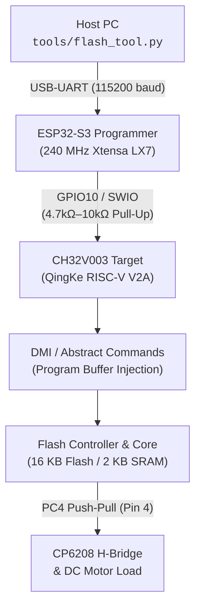
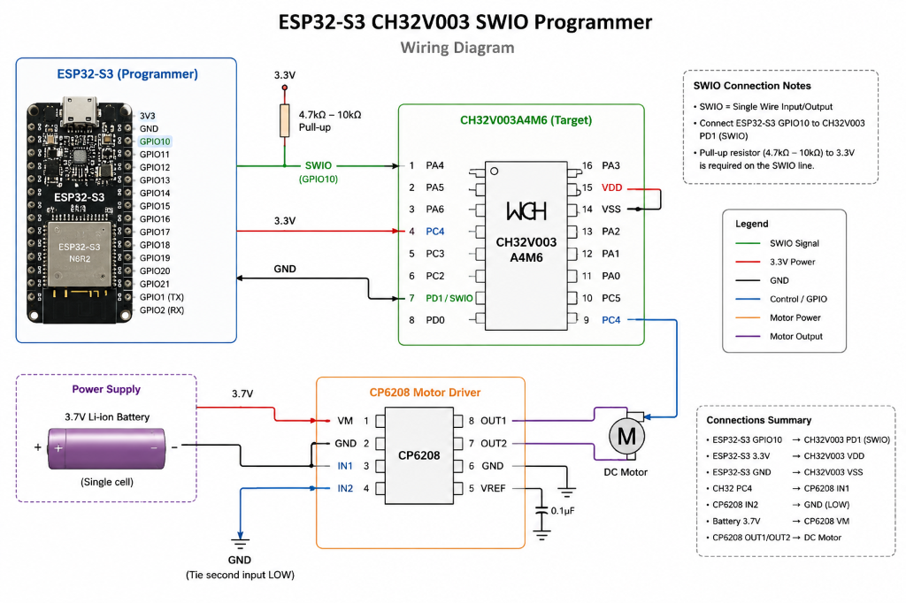
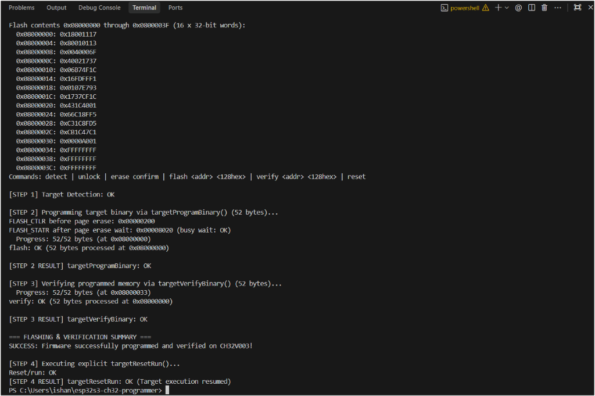
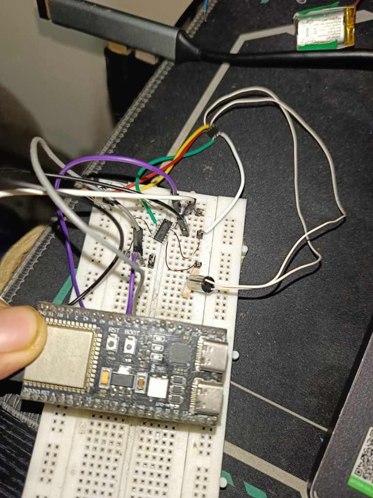

# ESP32-S3 CH32V003 SWIO Programmer

An open-source **ESP32-S3 based CH32V003 SWIO programmer/debugger with verified flash programming**.

[](LICENSE)
[](CHANGELOG.md)
[](tests/README.md)
[](firmware/programmer/platformio.ini)


*Physical hardware verification setup: ESP32-S3 programmer board interfaced to WCH CH32V003A4M6 target on breadboard.*

---

### Quick Value Proposition
* **Programmer MCU**: ESP32-S3 (240 MHz Xtensa LX7 dual-core).
* **Target MCU**: WCH CH32V003 (QingKe 32-bit RISC-V V2A core).
* **Interface**: 1-wire open-drain SWIO via ESP32-S3 **GPIO10** (requires external $4.7\text{k}\Omega - 10\text{k}\Omega$ pull-up).
* **Flashing Pipeline**: 3-stage flash unlock $\rightarrow$ 64-byte fast page erase $\rightarrow$ 64-byte page buffer write $\rightarrow$ byte-for-byte readback verification $\rightarrow$ explicit CPU reset/run.
* **Host Interface**: Standalone Python CLI utility ([`tools/flash_tool.py`](tools/flash_tool.py)) communicating over USB-UART (115200 baud).

---

## Hardware-Verified Baseline

The following capabilities have been tested and verified on physical hardware (**CH32V003A4M6 SOP-16**):

| Capability | Status | Baseline / Details |
| :--- | :---: | :--- |
| **SWIO Synchronization** | **Verified** | Line initialization and `0x5AA50400` handshake on `DMI_CONFIG` (0x7D) |
| **DMI Communication** | **Verified** | 32-bit DMI read/write framing; `DMSTATUS` (0x11) validation |
| **Target Detection** | **Verified** | Chip ID `0x0713BB91` and `DMHARTINFO` `0x002120F4` validation |
| **Memory Read** | **Verified** | Abstract command memory read via program buffer (`0x1FFFF704`, `0x08000000`) |
| **Flash Unlock** | **Verified** | 3-stage key sequence to `FLASH_KEYR`, `FLASH_OBKEYR`, `FLASH_MODEKEYR` |
| **Page Erase** | **Verified** | 64-byte granular page erase setting target words to `0xFFFFFFFF` |
| **Programming** | **Verified** | 64-byte fast buffer programming pipeline (`targetProgramBinary`) |
| **Readback Verify** | **Verified** | Byte-for-byte readback verification over DMI (100% match, 0 mismatches) |
| **Reset / Run** | **Verified** | Explicit DMI resume sequence (`targetResetRun`) clears halt and executes code |
| **Real Application Execution** | **Verified** | Bare-metal firmware driving physical DC motor load via CP6208 H-bridge |

---

## Architecture



The ESP32-S3 executes cycle-accurate SWIO physical signaling and DMI protocol operations directly in firmware, isolating the host computer from real-time bit-banging constraints. For full subsystem details, see [docs/architecture.md](docs/architecture.md).

---

## Quick Start

### 1. Build & Upload ESP32-S3 Programmer Firmware
```bash
cd firmware/programmer
pio run --target upload --upload-port COM10
```

### 2. Build CH32V003 Target Firmware
Requires `riscv64-unknown-elf-gcc` or `xpack-riscv-none-elf-gcc` (`-march=rv32ec -mabi=ilp32e`). See [docs/development.md](docs/development.md).
```bash
cd firmware/ch32_blink
make
```

### 3. Flash, Verify & Run Target Application
```bash
python tools/flash_tool.py --port COM10 --bin firmware/ch32_blink/blink.bin --addr 0x08000000 --reset
```

---

## Hardware Connections

### Pinout Reference
| ESP32-S3 Programmer | Direction | CH32V003A4M6 (SOP-16) | Function / Notes |
| :--- | :---: | :--- | :--- |
| **GPIO10** | $\longleftrightarrow$ | **Pin 7 (`PD1` / `SWIO`)** | 1-wire bidirectional debug line |
| **3.3V** | $\longrightarrow$ | **Pin 15 (`VDD`)** | Target core logic power (3.3V) |
| **GND** | $\longleftrightarrow$ | **Pin 14 (`VSS`)** | Common system ground |
| — | — | **Between Pin 7 & Pin 15** | $4.7\text{k}\Omega - 10\text{k}\Omega$ external pull-up resistor |
| — | $\longrightarrow$ | **Pin 4 (`PC4`)** | Push-pull GPIO output (drives CP6208 `AIN`) |

### Wiring Diagram

*Complete hardware wiring diagram: ESP32-S3 programmer, CH32V003A4M6 target MCU, CP6208 motor driver, and isolated battery power supply.*

### CP6208 DC Motor Demo Schematic
```
ESP32-S3               CH32V003A4M6 (SOP-16)            CP6208 Motor Driver
+----------+           +--------------------+           +-------------------+
|   GPIO10 +---+------>+ Pin 7  (PD1/SWIO)  |           |                   |
|          |   |       |                    |           |                   |
|     3.3V +---+[4.7k] | Pin 4  (PC4)       +---------->+ Pin 1 (AIN)       |
|          |   +------>+ Pin 15 (VDD)       |           |                   |
|      GND +---+------>+ Pin 14 (VSS)       +----+----->+ Pin 2 (GND)       |
+----------+   |       +--------------------+    |      |                   |
               |                                 +----->+ Pin 3 (BIN)       |
               |                                        |                   |
               |   External Motor Power Supply          |                   |
               |   +--------------------------+         |                   |
               |   | (+) Motor VCC (5V-12V)   +-------->+ Pin 6 (VCC)       |
               |   |                          |         |                   |
               +-->+ (-) Power GND            +         |   Pin 4 (OUT1)    |
                   +--------------------------+         |   Pin 5 (OUT2)    |
                                                        +-----+-------+-----+
                                                              |       |
                                                           +--+-------+--+
                                                           |   DC Motor  |
                                                           +-------------+
```

> [!IMPORTANT]
> **Power Rail Isolation**: Power the CH32V003 logic from the ESP32-S3 3.3V rail. Power the CP6208 motor supply ($V_{CC}$) from an independent external DC supply ($5\text{V}-12\text{V}$) to avoid inductive motor noise. Connect all grounds together. See [docs/hardware.md](docs/hardware.md) and [hardware/wiring/README.md](hardware/wiring/README.md).

---

## Development & Debugging Story

During hardware bring-up, four real physical and protocol issues were resolved:

* **Floating SWIO & `0xFFFFFFFF` Reads**: Early read operations timed out due to floating lines during turn-around. Resolved by installing a physical $4.7\text{k}\Omega - 10\text{k}\Omega$ pull-up to 3.3V and implementing active driven-high line preloading before release in [`swio.cpp`](firmware/programmer/swio.cpp).
* **Startup Synchronization**: The debug module requires a stable driven-high state on startup. Resolved by adding an active driven-high hold in `swioSynchronize()`.
* **Target Halt State**: After flashing, the core remained halted in debug mode. Resolved by implementing explicit `targetResetRun()` resume sequencing on `DMI_DMCONTROL` (0x10).
* **CP6208 Motor Input State Trap**: Initial motor runs failed because the CP6208 `BIN` input was floating HIGH (putting the driver in brake/bypass). Grounding `BIN` (Input B $\rightarrow$ GND) while `AIN` was driven by PC4 completed the forward drive circuit and spun the motor immediately.

For full register and protocol details, see [docs/protocol.md](docs/protocol.md).

---

## Hardware Proof & Output

*Verified on real CH32V003A4M6 hardware.*


*Real hardware terminal capture demonstrating CH32V003 detection, 64-byte page erase, flash programming, readback verification, and explicit target reset/run.*

```text
Loaded binary 'firmware/ch32_blink/blink.bin': 52 bytes
Target memory address: 0x08000000
Connecting to ESP32-S3 programmer on port COM10 (115200 baud)...

[STEP 1] Target Detection: OK (CH32 ID = 0x0713BB91, DMHARTINFO = 0x002120F4)
[STEP 2] Programming target binary via targetProgramBinary() (52 bytes): OK
[STEP 3] Verifying programmed memory via targetVerifyBinary() (52 bytes): OK (0 mismatches)
[STEP 4] Target Reset/Run: OK (Target execution resumed)

SUCCESS: Firmware successfully programmed and verified on CH32V003!
```

<details>
<summary><b>Click to view full initialization and verification trace</b></summary>

```text
Loaded binary 'firmware/ch32_blink/blink.bin': 52 bytes
Target memory address: 0x08000000
Connecting to ESP32-S3 programmer on port COM10 (115200 baud)...
=== PROGRAMMER INITIALIZATION LOG ===
Target detect: OK (CH32 ID = 0x0713BB91, DMHARTINFO = 0x002120F4)
Target memory read: OK (0x1FFFF704 = 0x0713BB91)

[STEP 1] Target Detection: OK

[STEP 2] Programming target binary via targetProgramBinary() (52 bytes)...
FLASH_CTLR before page erase: 0x00000200
FLASH_STATR after page erase wait: 0x00008020 (busy wait: OK)
  Progress: 52/52 bytes (at 0x08000000)
flash: OK (52 bytes processed at 0x08000000)
[STEP 2 RESULT] targetProgramBinary: OK

[STEP 3] Verifying programmed memory via targetVerifyBinary() (52 bytes)...
  Progress: 52/52 bytes (at 0x08000033)
verify: OK (52 bytes processed at 0x08000000)
[STEP 3 RESULT] targetVerifyBinary: OK

=== FLASHING & VERIFICATION SUMMARY ===
SUCCESS: Firmware successfully programmed and verified on CH32V003!

[STEP 4] Executing explicit targetResetRun()...
Reset/run: OK
[STEP 4 RESULT] targetResetRun: OK (Target execution resumed)
```

</details>

---

## Hardware Validation & Demo


*Real hardware demonstration: Bare-metal CH32V003 firmware programmed via ESP32-S3 driving a physical DC motor through a CP6208 H-bridge motor driver.*

The hardware baseline for this repository was verified using:
* **ESP32-S3 Programmer Board**: YD-ESP32-S3 / ESP32-S3-DevKitC-1 (N8R2, 240 MHz).
* **Target MCU**: WCH CH32V003A4M6 in SOP-16 package.
* **Physical Test Circuit**: Breadboard setup with $4.7\text{k}\Omega$ pull-up resistor, CP6208 motor driver, and mini DC motor.
* **Documentation & Procedures**: Detailed connection schematics and non-destructive test steps are maintained in [hardware/wiring/README.md](hardware/wiring/README.md) and [tests/README.md](tests/README.md).

---

## Repository Structure

| Path | Purpose |
| :--- | :--- |
| [`firmware/programmer/`](firmware/programmer/) | ESP32-S3 PlatformIO programmer firmware (SWIO, DMI, Flash engine, Serial CLI) |
| [`firmware/ch32_blink/`](firmware/ch32_blink/) | Bare-metal CH32V003 C application, RISC-V startup assembly, linker script, Makefile |
| [`tools/`](tools/) | Host Python flashing utility ([`flash_tool.py`](tools/flash_tool.py)) |
| [`docs/`](docs/) | Technical documentation suite ([`architecture.md`](docs/architecture.md), [`hardware.md`](docs/hardware.md), [`flashing.md`](docs/flashing.md), [`protocol.md`](docs/protocol.md), [`development.md`](docs/development.md)) |
| [`hardware/`](hardware/) | Hardware schematics and wiring references ([`hardware/wiring/README.md`](hardware/wiring/README.md)) |
| [`tests/`](tests/) | Hardware verification and regression test procedures ([`tests/README.md`](tests/README.md)) |

---

## Scope & Limitations

> [!WARNING]
> * **Hardware Scope**: Verified specifically on **WCH CH32V003A4M6** (SOP-16) and **ESP32-S3** (240 MHz). Other CH32 families (CH32V103/203/307) and other ESP32 variants (ESP32 classic, C3, C6) have different registers/timings and are untested.
> * **Not a WCH-LinkE Replacement**: This is a dedicated serial-to-SWIO flash programmer and target runner. It does not provide USB endpoint hardware emulation for MounRiver Studio, OpenOCD, or CMSIS-DAP.
> * **Single-Wire SWIO Only**: Tailored to the proprietary WCH 1-wire debug interface on pin `PD1`. Does not support 2-wire ARM SWD or 4-wire JTAG.
> * **Flash Programmer vs GDB Debugger**: Interacts with the Debug Module Interface for memory transfers, flash programming, and CPU restart, but does not provide GDB breakpoints, watchpoints, or single-stepping.
> * **External Pull-Up Required**: Requires an external $4.7\text{k}\Omega - 10\text{k}\Omega$ pull-up resistor on the SWIO line.

---

## Technical References & Attribution

This project builds upon open-source research and community documentation:

* **[ch32v003fun / minichlink](https://github.com/cnlohr/ch32v003fun)** by Charles Lohr (CNLohr): Foundational reference for WCH 1-wire SWIO protocol timing, DMI configuration registers (`0x7D`, `0x7E`), abstract command assembly injection templates, and 3-stage flash unlock keys.
* **[BlueSyncLine's CH32V003 SWIO implementation](https://github.com/BlueSyncLine/ch32v003-swio)**: Technical reference for single-wire protocol timing models and register structures.
* **[Nanjing Qinheng Microelectronics (WCH)](http://www.wch-ic.com)**: Official CH32V003 Reference Manual, QingKe V2 Microprocessor Manual, and standard peripheral definitions.

*Existing open-source implementations and community research were used as foundational technical references. The protocol framing and flash controller sequences build directly upon these proven reverse-engineering discoveries.*

---

## Project Roadmap

- [ ] Measure and benchmark sustained programming throughput across varying buffer chunk sizes.
- [ ] Validate broader CH32V00x package variants (CH32V003F4P6, CH32V003J4M6).
- [ ] Enhance host CLI tooling with automatic serial port detection and progress indicators.
- [ ] Add option byte (OB) read/write configuration CLI commands.
- [ ] Explore WebUSB / WebSerial browser-based flashing interface.
- [ ] Implement basic target register inspection and memory dump commands.

---

## Documentation Index

| Document | Path | Description |
| :--- | :--- | :--- |
| **System Architecture** | [`docs/architecture.md`](docs/architecture.md) | 6-subsystem modular software & hardware breakdown |
| **Hardware Reference** | [`docs/hardware.md`](docs/hardware.md) | Pinout tables, pull-up specs, and CP6208 motor schematic |
| **Flashing Workflow** | [`docs/flashing.md`](docs/flashing.md) | Host Python CLI options, memory bounds validation, and output logs |
| **Protocol Specification** | [`docs/protocol.md`](docs/protocol.md) | SWIO bit encoding, DMI register map, and flash controller registers |
| **Development Guide** | [`docs/development.md`](docs/development.md) | Toolchains, PlatformIO build commands, and RISC-V cross-compilation |
| **Wiring Schematics** | [`hardware/wiring/README.md`](hardware/wiring/README.md) | Visual wiring schematics and power domain isolation rules |
| **Test Procedures** | [`tests/README.md`](tests/README.md) | Non-destructive detection tests and end-to-end regression validation |
| **Changelog** | [`CHANGELOG.md`](CHANGELOG.md) | Release history and baseline milestones |
| **Roadmap** | [`TODO.md`](TODO.md) | Completed phase milestones and future development goals |

---

## License

This project is licensed under the [MIT License](LICENSE).  
Portions of the single-wire protocol timing and DMI register architecture build upon open-source research by Charles Lohr (CNLohr) in the `ch32v003fun` project and documentation from Nanjing Qinheng Microelectronics (WCH).
